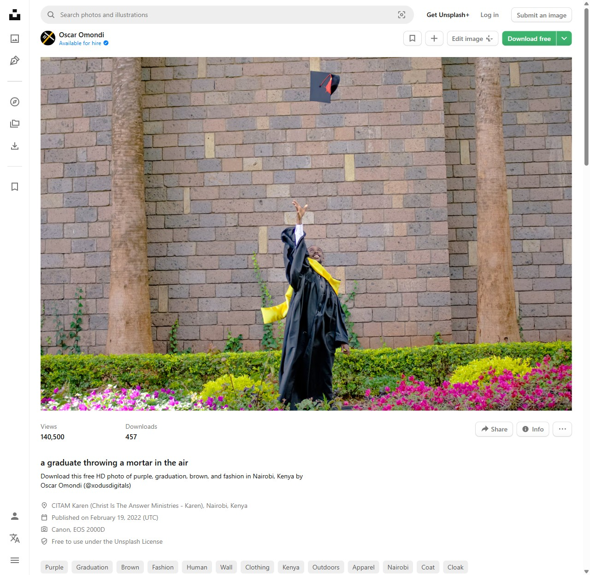
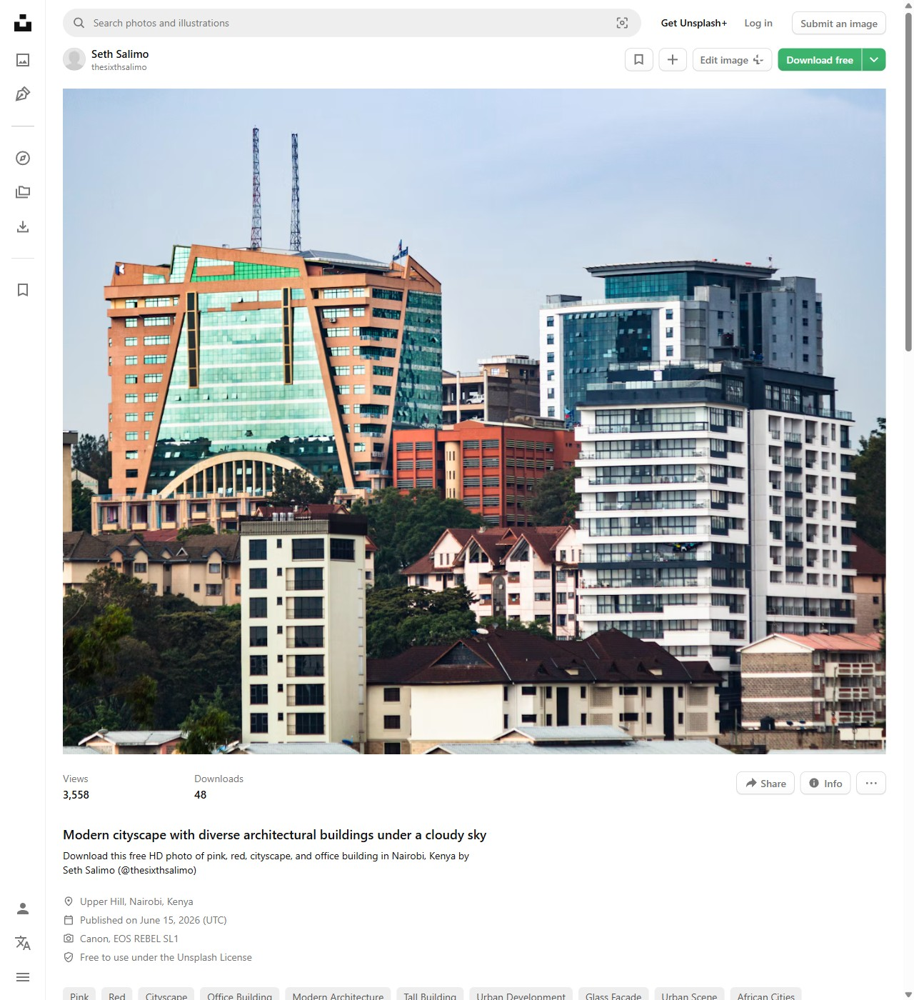
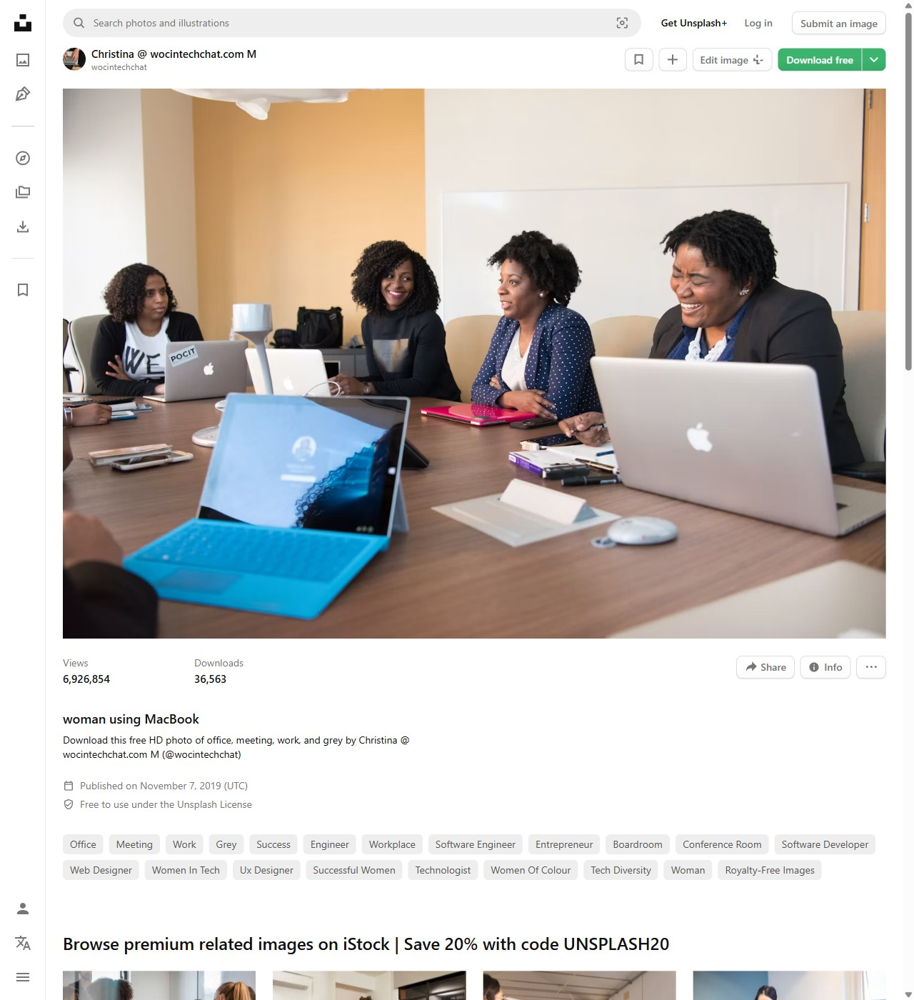
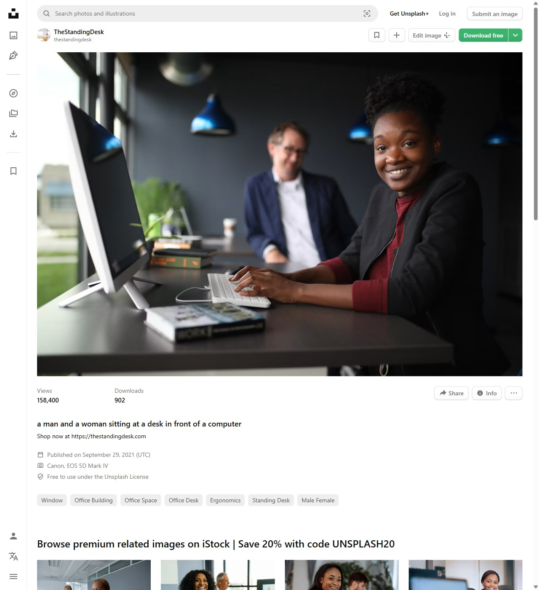
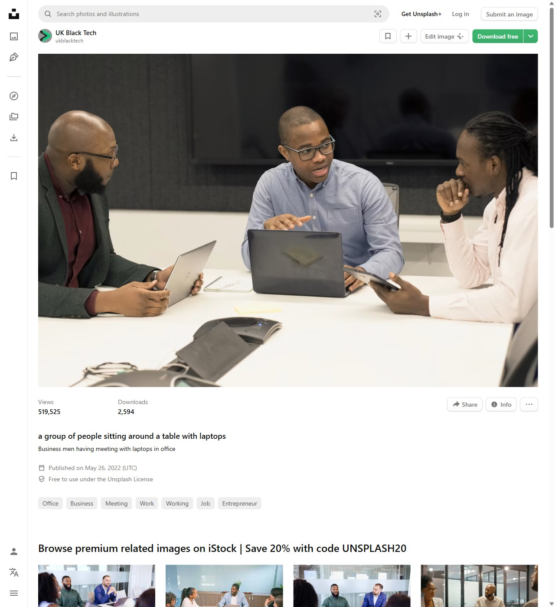

# Photo licence record

Evidence that every stock photo used on tafutakazi.co.ke is free to use. Keep this file up to date whenever a photo is added or removed.

## The licence

All photos below are from **Unsplash** and are published under the **Unsplash License**: https://unsplash.com/license

What the licence says (read on 17 October 2026; the page itself is the authority, so check it there):

- **The grant:** an irrevocable, non-exclusive, worldwide copyright licence to download, copy, modify, distribute, perform and use the images for free, **including for commercial purposes**.
- **Permission:** not needed.
- **Attribution:** not required (appreciated, but optional).
- **Not allowed:** selling the photos without significant changes, and compiling Unsplash photos to build a similar or competing service. We do neither.
- **Paid "Unsplash+" photos** are under a different licence. None of the photos below is an Unsplash+ photo: every photo page showed the line "Free to use under the Unsplash License".

The photos are loaded from Unsplash's own servers (`images.unsplash.com`), not copied onto our site.

## Photos in use

Checked one by one on **17 October 2026**, by opening each photo's Unsplash page and reading its licence line.

| # | Used on | Photo page | Photographer | Published on Unsplash | Licence line on the page |
|---|---|---|---|---|---|
| 1 | Blog: *Kenya's graduate jobs gap in 2026* (cover, and on /blog) | https://unsplash.com/photos/a-graduate-throwing-a-mortar-in-the-air-3RqAj1C40yo | Oscar Omondi (https://unsplash.com/@xodusdigitals) | 19 February 2022 | Free to use under the Unsplash License |
| 2 | Blog post, "A generation waiting in line" | https://unsplash.com/photos/a-group-of-people-in-graduation-gowns-posing-for-a-picture-J2jdh2Wiw-8 | Oscar Omondi (https://unsplash.com/@xodusdigitals) | 19 February 2022 | Free to use under the Unsplash License |
| 3 | Homepage "For employers" band; same post, "What the future looks like" | https://unsplash.com/photos/modern-cityscape-with-diverse-architectural-buildings-under-a-cloudy-sky-8JnXfVk6PdI | Seth Salimo (https://unsplash.com/@thesixthsalimo) | 15 June 2026 | Free to use under the Unsplash License |
| 4 | Same post, "Why the best graduates are being overlooked" | https://unsplash.com/photos/woman-using-macbook-KAULAzQwxzE | Christina @ wocintechchat.com (https://unsplash.com/@wocintechchat) | 7 November 2019 | Free to use under the Unsplash License |
| 5 | Same post, "What this means if you hire" | https://unsplash.com/photos/a-man-and-a-woman-sitting-at-a-desk-in-front-of-a-computer-U6RmGyT-aJ4 | TheStandingDesk (https://unsplash.com/@thestandingdesk) | 29 September 2021 | Free to use under the Unsplash License |
| 6 | Homepage "Software and IT" card; same post, after the opening | https://unsplash.com/photos/a-group-of-people-sitting-around-a-table-with-laptops-YDEiseFR_Q8 | UK Black Tech (https://unsplash.com/@ukblacktech) | 26 May 2022 | Free to use under the Unsplash License |

Image file IDs used in the site code (`web/src/blog/` and `web/src/pages/Home.tsx`): 1 `photo-1645262960735-1af893390f8b`, 2 `photo-1645262960690-5cb9db42d35a`, 3 `photo-1781504842018-c51ce0dac23f`, 4 `photo-1573167101669-476636b96cea`, 5 `photo-1632923943917-a1dd60878fa4`, 6 `photo-1653566031486-dc4ead13a35d`.

## Our own images
| Used on | File | Source |
|---|---|---|
| Homepage hero (four graduates looking at a phone) | `web/public/home/graduates.webp` | Supplied by Tafutakazi on 22 October 2026, not a stock photo. Record here how it was made (taken by us, or made with an AI image tool, and which one) and confirm we hold the rights. |
| About page, top (four graduates in caps on graduation day) | `web/public/about/graduates.webp` | Supplied by Tafutakazi on 22 October 2026, not a stock photo. Record how it was made and confirm we hold the rights. |
| Homepage "Data and analysis" card (laptop with a sales dashboard) | `web/public/home/data.webp` | Supplied by Tafutakazi on 22 October 2026. Record where it came from and confirm we may use it. |
| Homepage "Business and finance" card (desk with laptop, plans and coffee) | `web/public/home/business.webp` | Supplied by Tafutakazi on 22 October 2026. Record where it came from and confirm we may use it. |

## Screenshots

Taken on **17 October 2026** of each photo's Unsplash page, unedited, at 1280 pixels wide. Each shows the photographer, the photo, where and when it was published, and the line **"Free to use under the Unsplash License"**.

1. Oscar Omondi, graduate throwing a mortarboard: [photo-licences/1-oscar-omondi-3RqAj1C40yo.jpg](photo-licences/1-oscar-omondi-3RqAj1C40yo.jpg)
   
2. Oscar Omondi, graduates posing together: [photo-licences/2-oscar-omondi-J2jdh2Wiw-8.jpg](photo-licences/2-oscar-omondi-J2jdh2Wiw-8.jpg)
   
3. Seth Salimo, Nairobi skyline: [photo-licences/3-seth-salimo-8JnXfVk6PdI.jpg](photo-licences/3-seth-salimo-8JnXfVk6PdI.jpg)
   
4. Christina @ wocintechchat.com, professional on a laptop: [photo-licences/4-wocintechchat-KAULAzQwxzE.jpg](photo-licences/4-wocintechchat-KAULAzQwxzE.jpg)
   
5. TheStandingDesk, two colleagues at a desk: [photo-licences/5-thestandingdesk-U6RmGyT-aJ4.jpg](photo-licences/5-thestandingdesk-U6RmGyT-aJ4.jpg)
   
6. UK Black Tech, team meeting: [photo-licences/6-uk-black-tech-YDEiseFR_Q8.jpg](photo-licences/6-uk-black-tech-YDEiseFR_Q8.jpg)
   

For independent, dated proof, each Unsplash page can also be saved at https://web.archive.org/save

## How we use them

- Captions only describe the scene ("Graduation day in Nairobi."). We never suggest that anyone in a photo uses, endorses or is part of Tafutakazi, or is one of the people in our statistics.
- Photos are not edited to change their meaning.

## If someone complains

If a photographer or a person in a photo asks us to remove it:

1. Remove the photo from the site within 48 hours, whatever the reason. Swapping a stock photo costs nothing.
2. Reply politely, and point to this record and the photo's Unsplash page.
3. Note the date and what was removed below.

### Removals

None yet.
